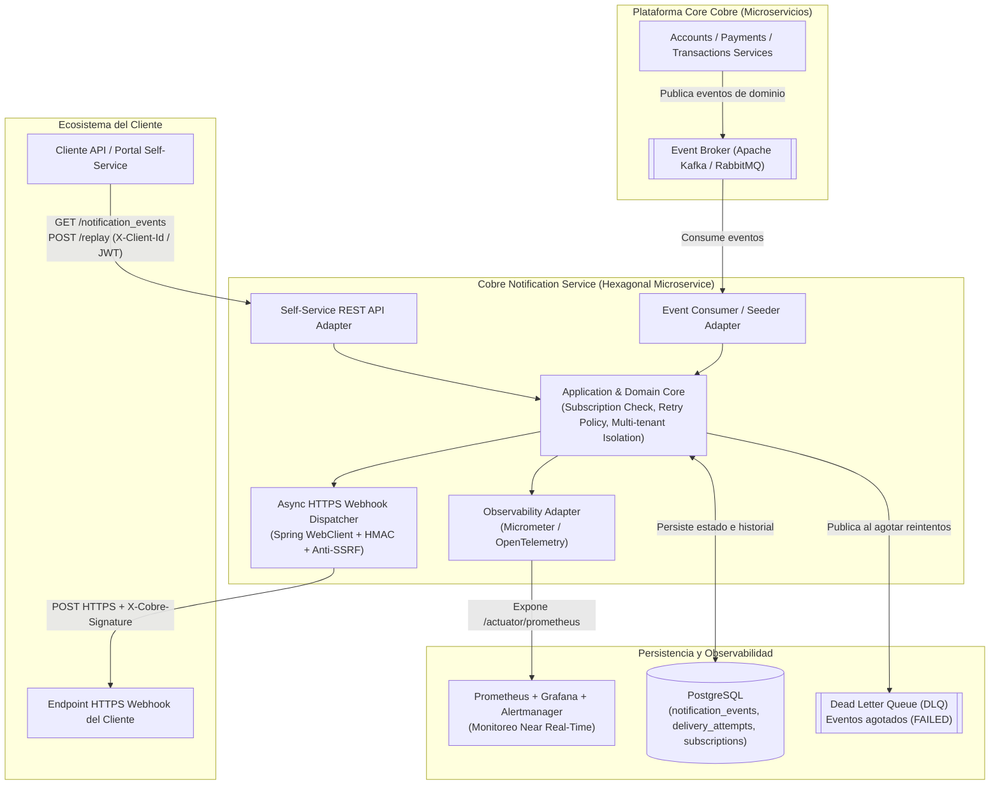
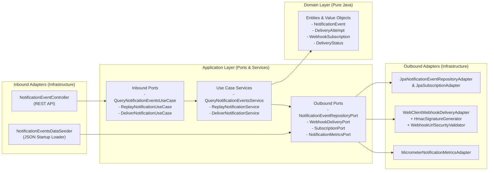
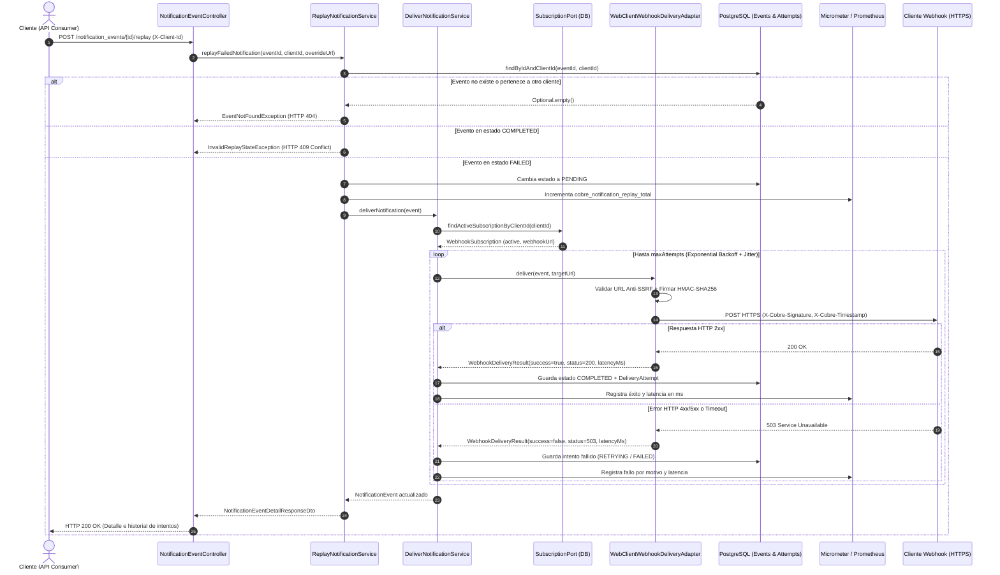
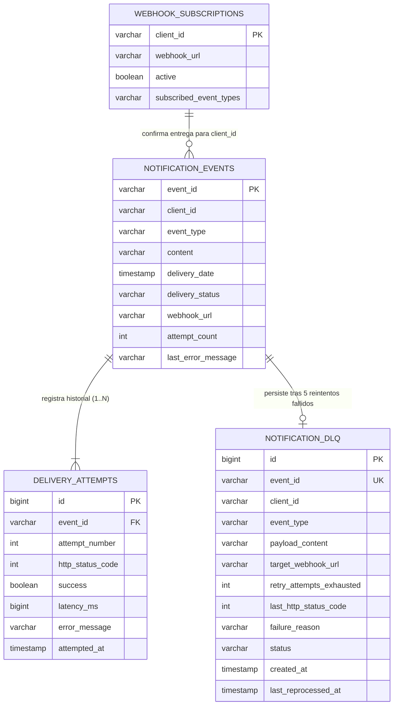

# Diseño del Sistema y Seguridad (Tasks 1 & 3)

Este documento detalla la propuesta arquitectónica para el motor de entrega de notificaciones vía webhooks y la API REST Self-Service de **Cobre** (**Task 1**), así como el análisis de vulnerabilidades **OWASP Top 10** y sus mitigaciones (**Task 3**).

---

## Task 1: System Design

### 1.1 Visión General y Escalabilidad Cloud-Native (Diagrama C4 - Contenedores)

En la plataforma transaccional y orientada a eventos de Cobre (cuentas, pagos, transacciones), el servicio de notificaciones se diseña separando el camino crítico de ingesta/despacho asíncrono y la API de autogestión (Self-Service) para escalar ambos de manera independiente:

### 1.2 Arquitectura Hexagonal Interna (Ports & Adapters)

La aplicación en Java 21 + Spring Boot 3.4 sigue una **Arquitectura Hexagonal estricta** donde las capas `domain` y `application` no dependen de anotaciones ni clases de Spring Data o Web:

### 1.3 Flujo de Entrega, Reintentos (Exponential Backoff + Jitter) y Replay

### 1.4 Modelo de Datos (Entity-Relationship)

### 1.5 Observabilidad Near Real-Time

Para que el equipo de monitoreo interno detecte desviaciones en tiempo casi real y responda de inmediato ante reclamos de clientes, el servicio expone en `/actuator/prometheus`:
1. **`cobre_notification_delivery_total{status="success|failure", client_id, event_type, reason}`**: Permite alertar si la tasa de fallos (`status="failure"`) de un cliente específico o global supera un umbral en una ventana de 1–5 minutos.
2. **`cobre_notification_delivery_latency_seconds{status, client_id}`**: Mide la latencia exacta de respuesta de los servidores webhook de cada cliente para distinguir lentitud del endpoint del cliente frente a problemas internos de plataforma.
3. **`cobre_notification_replay_total{client_id}`**: Monitorea picos de reenvíos manuales por cliente.

---

## Task 3: Seguridad (OWASP Top 10 / OWASP API Security Top 10)

Dado que la API de Cobre puede ser consumida públicamente a través de Internet y además realiza peticiones salientes hacia URLs provistas por clientes, se identificaron **4 vulnerabilidades críticas** y se implementaron sus mitigaciones:

### 1. Broken Object Level Authorization (BOLA / IDOR) — *OWASP API1:2023 / A01:2021*
- **Riesgo en Cobre**: Un cliente autenticado (`CLIENT001`) podría intentar consultar el detalle de una notificación o disparar el replay de un evento perteneciente a otro cliente (`CLIENT002`, por ejemplo `GET /notification_events/EVT003` o `POST /notification_events/EVT003/replay`) adivinando o iterando el identificador del evento, violando el requerimiento obligatorio de aislamiento por cliente.
- **Mitigación implementada**:
  1. **Consultas parametrizadas por tenencia en base de datos**: `NotificationEventRepositoryPort.findByIdAndClientId(eventId, clientId)` exige que tanto el `event_id` como el `client_id` coincidan en la cláusula `WHERE` de SQL.
  2. **Validación anti-suplantación en el controlador**: [`NotificationEventController`](./src/main/java/com/cobre/notification/infrastructure/adapter/inbound/rest/NotificationEventController.java) valida que el encabezado de identidad (`X-Client-Id` / claim del token JWT en API Gateway) nunca difiera del parámetro `client_id`, devolviendo `403 Forbidden` ante cualquier discrepancia y `404 Not Found` cuando un recurso no pertenece al cliente (evitando enumeración de IDs).

### 2. Server-Side Request Forgery (SSRF) — *OWASP API7:2023 / A10:2021*
- **Riesgo en Cobre**: Como el motor de webhooks realiza peticiones HTTP salientes hacia una URL configurada por el cliente, un atacante podría configurar una URL maliciosa apuntando a la red interna de Cobre o al servicio de metadatos de nube (por ejemplo, `https://169.254.169.254/latest/meta-data/iam/security-credentials/`, `https://localhost:8080/actuator` o rangos internos `10.x.x.x` / `192.168.x.x`).
- **Mitigación implementada**:
  1. En [`WebhookUrlSecurityValidator`](./src/main/java/com/cobre/notification/infrastructure/adapter/outbound/http/WebhookUrlSecurityValidator.java) se exige el esquema `https://` y se resuelve el DNS del host destino antes de despachar la petición, bloqueando con `SecurityException` cualquier dirección IP *loopback* (`127.0.0.1`, `::1`), *link-local* (`169.254.0.0/16`), *site-local* / privada RFC 1918 (`10.0.0.0/8`, `172.16.0.0/12`, `192.168.0.0/16`) o *multicast*.
  2. Timeouts estrictos de conexión (`3000 ms`) y lectura (`5000 ms`) en `WebClientConfig` para evitar agotamiento de sockets por endpoints lentos (*Slowloris*).

### 3. Security Misconfiguration & Software/Data Integrity Failures — *OWASP API8:2023 / A08:2021*
- **Riesgo en Cobre**:
  1. Un atacante externo podría enviar peticiones falsas al endpoint webhook del cliente haciéndose pasar por Cobre (*Webhook Spoofing*).
  2. Un atacante podría interceptar o reenviar (*replay attack*) un webhook antiguo para duplicar una acreditación de saldo o pago en el sistema del cliente.
- **Mitigación implementada**:
  1. **Firma criptográfica `HMAC-SHA256`**: [`HmacSignatureGenerator`](./src/main/java/com/cobre/notification/infrastructure/adapter/outbound/http/HmacSignatureGenerator.java) firma el timestamp concatenado con el cuerpo JSON (`timestamp + "." + payloadJson`) usando el secreto compartido del cliente y envía los encabezados `X-Cobre-Signature: sha256=<hex>` y `X-Cobre-Timestamp`.
  2. **Transporte cifrado TLS/HTTPS y contenedor sin privilegios**: Exigencia de HTTPS en entregas salientes, política `STATELESS` en Spring Security y ejecución del contenedor Docker bajo un usuario no-root (`USER cobre`).

### 4. Unrestricted Resource Consumption (Rate Limiting / Replay Abuse) — *OWASP API4:2023*
- **Riesgo en Cobre**: Un cliente con un script automatizado mal configurado podría invocar masivamente `POST /notification_events/{id}/replay` o consultas sin acotar, saturando los hilos de salida HTTP y la base de datos.
- **Mitigación implementada y recomendada en Gateway**:
  1. **Máquina de estados de dominio**: [`NotificationEvent.canBeReplayed()`](./src/main/java/com/cobre/notification/domain/model/NotificationEvent.java) solo permite el reenvío si el evento se encuentra estrictamente en estado `FAILED`, cambiando inmediatamente su estado a `PENDING` antes del despacho y rechazando con `409 Conflict` cualquier intento de reenviar eventos completados.
  2. **Circuit Breaker y Bulkhead con Resilience4j**: Configuración de ventana deslizante y umbral de fallos en `application.yml` junto con *Rate Limiting* por `client_id` en el API Gateway.

